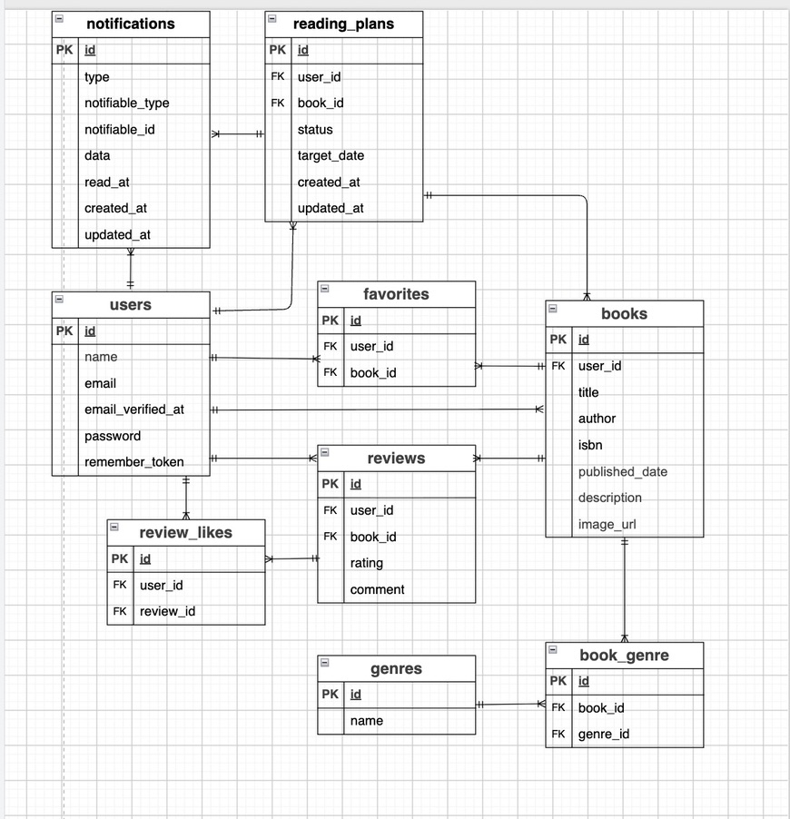

# BookShelf 書籍レビューアプリ

## 1️⃣ 概要

書籍の登録・管理やレビュー投稿、お気に入り登録などができる書籍管理Webアプリです。

書籍情報の検索にはGoogle Books APIを使用し、読書計画の登録やリマインド通知などの機能も実装しています。

## 2️⃣ 主な機能

* ユーザー登録・ログイン
* 書籍の登録・編集・削除
* 書籍検索
* ジャンル登録・検索
* レビュー投稿
* お気に入り登録
* いいね機能
* 書籍ランキング表示
* Google Books APIによる書籍検索
* 読書計画の登録・管理
* 読書計画のリマインド通知
* APIによる書籍情報の取得・登録・更新・削除

## 3️⃣ ER図



## 4️⃣ 環境構築

### 前提条件

以下のソフトウェアをインストールしてください。

- Docker Desktop
- Git

### 1. リポジトリをクローン

任意のディレクトリで、以下のコマンドを実行します。

```bash
git clone https://github.com/daiki-oishi-0206/bookshelf-app.git
cd bookshelf-app
```

### 2. 環境変数の設定

`.env.example` をコピーして `.env` を作成します。

```bash
cp .env.example .env
```

`.env` のデータベース接続設定を以下のようにします。

```env
DB_CONNECTION=mysql
DB_HOST=mysql
DB_PORT=3306
DB_DATABASE=laravel
DB_USERNAME=sail
DB_PASSWORD=password
```

Google Books APIを利用する場合は、取得したAPIキーを設定します。

```env
GOOGLE_BOOKS_API_KEY=取得したAPIキー
```

### 3. Composerの依存パッケージをインストール

Dockerを使用してComposerの依存パッケージをインストールします。

```bash
docker run --rm \
  -u "$(id -u):$(id -g)" \
  -v "$(pwd):/var/www/html" \
  -w /var/www/html \
  laravelsail/php82-composer:latest \
  composer install
```

### 4. Laravel Sailの起動

Dockerコンテナをバックグラウンドで起動します。

```bash
./vendor/bin/sail up -d
```

Laravelのアプリケーションキーを生成します。

```bash
./vendor/bin/sail artisan key:generate
```

### 5. フロントエンドの依存パッケージをインストール

npmパッケージをインストールします。

```bash
./vendor/bin/sail npm install
```

### 6. データベースの構築

マイグレーションとシーダーを実行し、テーブルと初期データを作成します。

```bash
./vendor/bin/sail artisan migrate --seed
```

### 7. アプリケーションの起動

フロントエンドの開発サーバーを起動します。

```bash
./vendor/bin/sail npm run dev
```

## 5️⃣ API認証

Laravel Sanctumを使用してAPI認証を行っています。

| エンドポイント                       | 認証 |
| ----------------------------- | -- |
| GET `/api/v1/books`           | 不要 |
| GET `/api/v1/books/{book}`    | 不要 |
| POST `/api/v1/books`          | 必要 |
| PUT `/api/v1/books/{book}`    | 必要 |
| DELETE `/api/v1/books/{book}` | 必要 |

`PUT`・`DELETE`は、ログインユーザー自身が登録した書籍のみ操作できます。

## 6️⃣ APIエンドポイント一覧

| Method | URL                    | 内容     |
| ------ | ---------------------- | ------ |
| GET    | `/api/v1/books`        | 書籍一覧取得 |
| GET    | `/api/v1/books/{book}` | 書籍詳細取得 |
| POST   | `/api/v1/books`        | 書籍登録   |
| PUT    | `/api/v1/books/{book}` | 書籍更新   |
| DELETE | `/api/v1/books/{book}` | 書籍削除   |

## 7️⃣定期実行（日次バッチ）

読書計画の期日超過処理とリマインダー通知は、毎日20:00に実行されるよう設定されています。

### 設定手順

1. Dockerコンテナを起動します。

   ```bash
   ./vendor/bin/sail up -d
   ```

2. Laravelのスケジュール設定を確認します。

   ```bash
   ./vendor/bin/sail artisan schedule:list
   ```

3. cronを設定します。

   ```bash
   crontab -e
   ```

 　開いたファイルの末尾に、次の設定を追加します。

   ```cron
   * * * * * cd /プロジェクトの絶対パス/bookshelf-app && ./vendor/bin/sail artisan schedule:run >> /tmp/bookshelf-scheduler.log 2>&1
   ```

   /プロジェクトの絶対パス は、プロジェクトのディレクトリに移動して、次のコマンドで確認してください。

   ```bash
　　pwd
   ```

　　例えば、/Users/ユーザー名/bookshelf-app と表示された場合は、そのパスに置き換えます。

4. 設定を確認します。

   ```bash
   crontab -l
   ```

cronが毎分Laravelのスケジュールを確認し、設定された時刻に日次バッチを実行します。

※ cronの設定は各自のMacで行う必要があります。

## 8️⃣ 使用技術

| 技術               | 内容           |
| ---------------- | ------------ |
| PHP              | 8.5          |
| Laravel          | 10.x         |
| MySQL            | 8.4          |
| Docker           | Laravel Sail |
| Tailwind CSS     | CSSフレームワーク   |
| Alpine.js        | JavaScript   |
| Laravel Sanctum  | API認証        |
| Google Books API | 書籍情報取得       |
| phpMyAdmin       | データベース管理     |
| Git / GitHub     | バージョン管理      |

## 9️⃣ 開発環境URL

### アプリケーション

http://localhost

### phpMyAdmin

http://localhost:8080

## 🔟 開発時の確認

## テスト

以下のコマンドでテストを実行できます。

```bash
./vendor/bin/sail artisan test
```

全テストが通過することを確認しています。

### コードフォーマット

```bash
./vendor/bin/sail pint
```

### コードフォーマットの確認

```bash
./vendor/bin/sail pint --test
```


## 作成者

大石大樹
